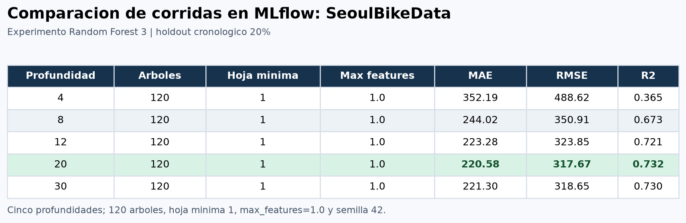

# Análisis de resultados

Se compararon cinco corridas en el experimento `SeoulBikeData - experimentacion Random Forest`. En todas se usaron 120 árboles, `min_samples_leaf=1`, `max_features=1.0`, semilla 42 y la misma partición cronológica (7,008 filas de entrenamiento y 1,752 de prueba, del 19 de septiembre al 30 de noviembre de 2018). Solo varió `max_depth`.

| Profundidad | MAE | RMSE | R² |
|---:|---:|---:|---:|
| 4 | 352.19 | 488.62 | 0.365 |
| 8 | 244.02 | 350.91 | 0.673 |
| 12 | 223.28 | 323.85 | 0.721 |
| 20 | **220.58** | **317.67** | **0.732** |
| 30 | 221.30 | 318.65 | 0.730 |

La mejor configuración probada fue `max_depth=20`: obtuvo el menor MAE y RMSE y el mayor R². Superó la regresión lineal original, medida en el mismo holdout (MAE 314.29, RMSE 412.12 y R² 0.549), reduciendo el MAE cerca de 29.8%. El principal efecto visible fue el de la profundidad: pasar de 4 a 8 redujo el MAE en 108 bicicletas/hora; después las ganancias fueron pequeñas y a profundidad 30 empeoró ligeramente. Esto identifica a `max_depth` como el factor más influyente **en este barrido**, no como resultado de una búsqueda exhaustiva de interacciones.

La repetición de la configuración con profundidad 20 produjo exactamente las mismas métricas registradas en la primera ejecución. La captura de la interfaz compara las cinco profundidades distintas; excluye la repetición de profundidad 20 y la corrida de validación de valores por defecto.

## Evidencia de comparación

La siguiente tabla se exportó directamente de las cinco corridas finalizadas del experimento MLflow. También se incluyen capturas de la vista de comparación de MLflow con los nombres de las cinco corridas y los parámetros/métricas visibles.

- [Vista MLflow con las cinco corridas](screenshots/mlflow-parametros.png)
- [Vista MLflow con parámetros y métricas](screenshots/mlflow-metricas.png)

Las conclusiones tienen límites: se evaluó un único holdout temporal tardío de un dataset de un año, sin validación de origen móvil; otra estación o año podría cambiar el ranking. Se dejaron fijos `n_estimators`, `min_samples_leaf` y `max_features`, así que no se estimó su efecto ni sus interacciones. Además, no se incluyeron rezagos de demanda; la fuerte dependencia horaria/estacional podría justificar un análisis de serie temporal y una evaluación con varios periodos antes de uso operativo.
